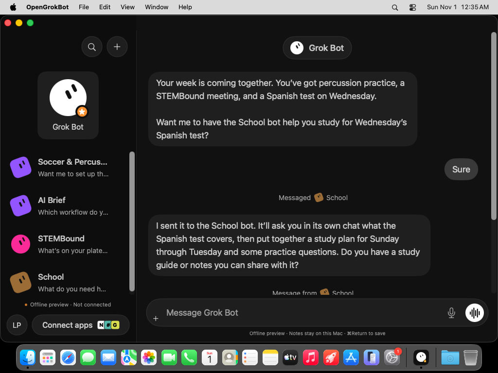
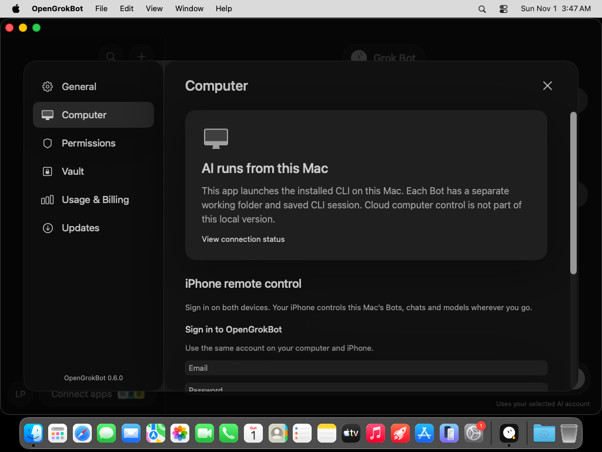
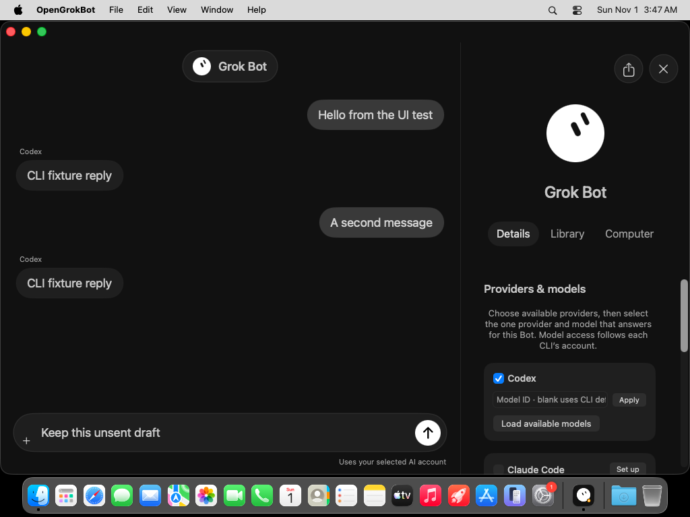

# OpenGrokBot

A free, open-source chat app for **AI CLIs installed on your own computer**, with optional **Composio** tool connections. macOS is the priority: native SwiftUI/AppKit, Liquid Glass on macOS 26, and a universal Apple Silicon/Intel DMG. Windows has an Electron app and Setup EXE. The iOS app signs into the same Supabase account as your Mac or Windows desktop and controls its existing workspace through an encrypted device relay.

Start with **one empty assistant named Grok Bot**. There are no seeded conversations or extra Bots. Ask Grok Bot to create specialists, or add your own Bots when you want separate conversations.

[Downloads](docs/DOWNLOADS.md) · [Setup guide](docs/SETUP.md) · [Verification](docs/VERIFICATION.md) · [Source review](https://github.com/carboy285/opengrokbot/pull/1)



## First launch

1. Choose **Codex**, **Claude Code**, **Grok Build**, **OpenCode**, or **Gemini CLI**.
2. Let the app find your installed CLI, or choose its executable. If it is missing, follow its official installation guide.
3. Sign in through the CLI in your Terminal. The app checks Codex login status; other providers validate their configured account on the first message.
4. Optionally enter your **Composio project API key**, choose tools, and authorize each account in your browser. Return and refresh connections.
5. Start chatting. Each Bot keeps a separate CLI session. You can stop a response, retry a failed response, switch providers, and export conversation text.

The app is free. AI providers, local model configurations, and Composio have their own pricing, quotas, and requirements. Free inference is not guaranteed.

## Platforms

| Platform | Implementation | Distribution |
| --- | --- | --- |
| macOS 14+ | Native SwiftUI/AppKit; Liquid Glass on macOS 26, material fallback earlier | Universal `.app` in a drag-to-Applications `.dmg` |
| Windows x64 | Electron with an isolated, sandboxed renderer | NSIS Setup `.exe` |
| iOS 18+ | Native SwiftUI remote controller for the desktop’s Bots/chats/models | Xcode project; shared sign-in and locally approved Mac access |

The development Mac build is ad-hoc signed and not notarized. The Windows build is unsigned. iPhone device installation requires your own signing team. See the [Mac](docs/MACOS.md), [Windows](docs/WINDOWS.md), and [iPhone](docs/DEVICE_SETUP.md) guides.

## iPhone remote control

In Mac **Settings → Computer → iPhone remote control**, create an email account, confirm the email, sign in and enable **Allow phone access**. Sign into the same account on your iPhone. Compare its device fingerprint and select **Approve phone** on the Mac, then choose your Mac on the phone. No VPN, pairing URL or router setup is required.

The phone controls the same Bots, chats, memories, active models and running tasks without saving an independent workspace. Supabase handles accounts, device discovery and encrypted temporary packets; the Mac runs all AI CLIs. Revoke individual phones on the Mac. Google/GitHub buttons appear after their providers are configured in Supabase. Default Supabase email delivery is restricted to project-team addresses; custom SMTP is needed for general signup. See the [connection guide](docs/REMOTE_ACCESS.md).



**0.7.3** hides the horizontal scrollbar under pinned Bots on Mac while preserving sideways scrolling. [Downloads](docs/DOWNLOADS.md).

The **0.7.2 update** improves remote bot loading between Windows, Mac and iPhone with a smaller initial roster, compatible workspace replies, reconnect controls and visible errors. It also adds recent-use sorting for unpinned Bots, visible local Bot browsers and Linux VM setup through UTM/VirtualBox. See [0.7.2 remote setup and limits](docs/REMOTE_0_7_2.md). It retains [0.7.1 features](docs/BUGFIX_0_7_1.md), including shared pins and scheduled tasks. Local browser profiles replace the cloud-browser requirement.

## Bots, models and teamwork

Click the Bot’s name at the top of a conversation to open its side panel. **Details** contains provider and model controls; **Library** lists real files in its working folder; **Computer** shows its local runtime. Enable providers you want available, then choose **one active provider** and its model. Only that selected model answers for that Bot. Codex and OpenCode can load their local model catalogs; exact model IDs can also be entered. A blank model uses the CLI’s default.



Press **Enter** to send; **Shift+Enter** adds a line break. Your unsent draft stays in place when the side panel opens.

Try: “Make me a bot called Travel that plans trips, keeps answers short, and never books without asking.” The assistant can create the Bot with its job description and selected model, save private or shared memories, and send another Bot a request with just the relevant context. The specialist answers asynchronously in its own chat and returns a labeled reply to the requesting chat. Ask for a group with 2–8 existing Bots to work in a shared conversation; each member uses its own selected model. No extra Bots exist at first launch.

Operations apply only after successful CLI completion. The app records messages as coming from Bots, never as human messages or approvals. Internal operations do not include external sending, purchases, approval, or Bot deletion. Only the user-facing sidebar Delete action deletes Bots. CLI and Composio permissions still govern external tools. Model cooperation is required; fixture tests establish routing and persistence, not how reliably a live model follows the protocol. Teamwork is limited to 8 operations per turn, 12 deliveries per chain and 4 hops.

## Chat and tools

The desktop apps launch actual local CLI subprocesses. Prompts use stdin; Grok Build uses a private temporary prompt file because its documented headless mode requires that. Structured events update replies, and provider session IDs resume subsequent messages. Adapters cover each provider’s documented headless format; account/model availability is determined by that installed CLI.

Composio setup uses the documented v3.1 Tool Router API with a stable, randomly generated user ID for this installation and an explicit toolkit allowlist. Authorization links and connection states come from Composio. Selected tools reach the CLI through an app-bundled stdio MCP proxy. The **project API key is never passed to the CLI or model**; the proxy uses the scoped MCP session URL returned by Composio. Connection management is handled in the app rather than automatically by the model.

The app does not add approval-bypass flags. Codex runs with a read-only local workspace; other providers retain their configured permissions. Remote MCP tool actions can change connected accounts’ data according to the CLI’s tool permissions and your Composio authorization. Review those settings before asking the assistant to act.

This independent app does not sign in to the proprietary Grok Bot service, sync its cloud Bots, or control its cloud computer. Historical binary investigation is documented separately in [HARNESS.md](docs/HARNESS.md). It is not needed for local CLI chat.

## Data and credentials

**Optional provider API keys (macOS).** Subscriptions (ChatGPT, Claude, Grok) work by signing in through the provider's CLI; no key is needed. To use pay-per-token API access instead, open **Settings → API Keys** and save a key for Codex/OpenAI (`CODEX_API_KEY` and `OPENAI_API_KEY`), Claude Code (`ANTHROPIC_API_KEY`), Grok Build (`XAI_API_KEY`) or Gemini CLI (`GEMINI_API_KEY`). A saved key replaces that CLI's sign-in until removed, so usage is billed to the API account. Keys are kept in the Mac Keychain and passed to that CLI only through its process environment, never in arguments, files, or prompts. OpenCode keeps its own keys (`opencode auth login`). The Windows app does not have this setting yet.

Conversation text and session IDs are stored locally in normal application data directories. AI CLIs send prompts to their configured provider or local model. CLI login credentials remain with those CLIs.

Composio project credentials and scoped session URLs stay in **macOS Keychain** or **Windows encrypted device storage**. They are not placed in command arguments, generated MCP configuration files, or logs. MCP configuration uses environment placeholders in private per-Bot working directories. Composio API requests go to its fixed HTTPS origin; returned browser/MCP URLs must use trusted Composio HTTPS hosts. Removing the project locally stops access from new runs; revoke connected accounts in Composio to remove authorization at the service.

The separate device vault stores secure notes in Keychain/Windows data protection. It is not exposed to Bots. Older preview workspaces migrate away from known fixtures while preserving authored notes and custom Bots; the original workspace is backed up before migration.

The Mac app runs outside App Sandbox so it can execute CLIs installed on the host. The Windows renderer has no Node access; the main process validates IPC and owns subprocesses, credentials, and tool connections.

## Build

On a Mac with Xcode 26+:

```bash
./scripts/build-macos.sh
```

Or open `GrokBot.xcodeproj`, select **GrokBotMac > My Mac**, and run. The MCP helper is built and embedded automatically. Select **GrokBot** for the iOS source target.

On Windows with Node.js:

```powershell
npm ci
npm run start:windows
npm run dist:windows
```

Apple targets have no third-party runtime dependencies. Windows dependencies are pinned in `package-lock.json`. The supplied screenshots inform the dark layout, avatars, centered chat header, glass composer, and settings. Native Apple glass is used on supported OS/SDK versions; Windows uses its own translucent styling. Pixel-perfect equality with the references has not been established.

## Verification and limits

```bash
python3 -m pip install -r scripts/check-requirements.txt
python3 scripts/check_project.py
python3 -m unittest discover -s scripts -p 'test_*.py' -v
npm ci
npm run test:desktop
npm run test:cloud
CHROMIUM_PATH=/path/to/chromium npm run test:ui
```

Native CI compiles Apple targets, runs XCTest, builds the universal DMG, captures actual Mac windows, and builds/tests the Windows app and installer. Tests include real fixture subprocesses, saved-session resumption, Unicode replies, Composio request contracts, MCP JSON/SSE transport, secret redaction, persistence, and encryption. Test fixtures are separate from production replies.

Live model inference and Composio OAuth/tool execution require configured user accounts. A Composio project key was not supplied during implementation, so live authorization and tool execution are unverified. Voice, file attachments, a built-in cloud computer, remote screen sharing, and power/wake management are not implemented. Physical-phone roaming, live email delivery and OAuth provider sign-in have not been exercised with user accounts. See [verification details](docs/VERIFICATION.md).

## License

Original code and geometric artwork are [MIT licensed](LICENSE). This project is not affiliated with xAI, Anthropic, OpenAI, Google, Cursor, or Composio. Proprietary binaries and assets are not redistributed.
