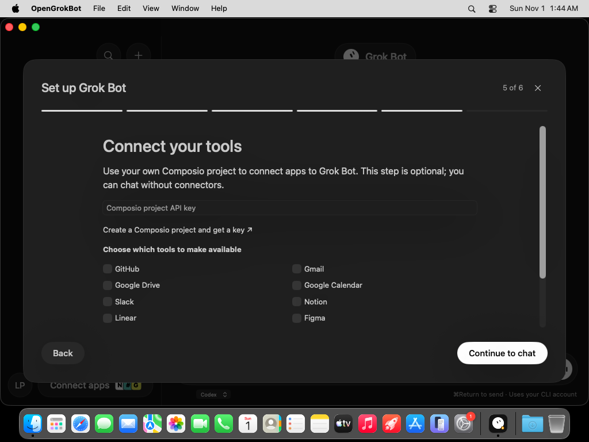

# Set up Grok Bot

Install the Mac DMG or Windows Setup EXE from [Downloads](DOWNLOADS.md). OpenGrokBot opens a six-step guide on first launch. Open it again from the CLI status in the sidebar or Settings.

## Choose and install an AI CLI

Choose one installed on the computer hosting the app:

| CLI | Installation and account guide | Sign-in command |
| --- | --- | --- |
| Codex | [Official guide](https://github.com/openai/codex#quickstart) | `codex login` |
| Claude Code | [Official guide](https://code.claude.com/docs/en/setup) | `claude` |
| Grok Build | [Official guide](https://github.com/xai-org/grok-build#installing-the-released-binary) | `grok` |
| OpenCode | [Official guide](https://opencode.ai/docs/) | `opencode auth login` |
| Gemini CLI | [Official guide](https://geminicli.com/docs/get-started/installation/) | `gemini` |

The app scans PATH and common installation directories. Use **Choose executable** if yours is elsewhere. On Windows, known npm `.cmd` launchers are resolved to their package’s JavaScript entry point and run without passing user prompts through a shell. Native executable paths are supported too.

The guide shows installation commands, copies them on request, and opens the official documentation. It does not install packages or sign in on your behalf. Follow your CLI’s own authentication and model configuration instructions. Codex’s local login status can be checked; other providers validate authentication when the first message is sent.

## Connect Composio, optionally

1. Create your own project at [Composio](https://platform.composio.dev).
2. Get a **project API key** with permission to create/read Tool Router sessions and initiate connections. Follow [Composio’s key-permission guide](https://docs.composio.dev/kb/guide/platform-project-api-key-permissions).
3. In setup or **Connect Apps**, enter the key and select the tools you want available.
4. Select **Connect project**. The app creates a session restricted to those toolkits for a unique local user ID.
5. Select **Connect** beside a tool. Complete the Composio authorization flow in your browser. It may require configuring an auth integration in your project.
6. Return and select **Refresh connections**. A tool is shown as connected only when Composio reports an active account.

You can skip Composio entirely and chat through your CLI. You can also connect tools later. Service plans, auth configuration, and availability are controlled by Composio, not bundled with this app.

The project key and MCP capability URL are stored securely on the device. The project key is not given to the CLI. The CLI receives a session-scoped MCP connection through a bundled helper and retains its own tool permission controls. To change tool selection, stop active responses, remove the local project configuration, and set it up again. Local removal does not revoke existing OAuth grants; use Composio’s dashboard for that.

## Start chatting

The workspace starts with only **Grok Bot** and an empty conversation. Type a message, then use **Command-Return** on Mac or **Control-Enter** on Windows. Each added Bot has a separate saved session. Switching providers keeps their sessions separate.

If the CLI fails, the app preserves the user message and displays an error with a retry option. Check sign-in, provider configuration, and CLI version in Terminal. Stop a response using **Stop**. Responses time out after ten minutes. Conversation text is stored locally and may be included in normal device backups.

The application is free and open source. AI inference and Composio usage follow the selected providers’ terms and quotas. Use a local model through a supported CLI if that fits your setup; the app does not bundle a model or guarantee free API access.

## iPhone

iOS cannot spawn a desktop CLI. This version includes the native iOS interface and desktop setup guide, but **secure desktop host pairing is not yet implemented**. Use the Mac or Windows app for chat. No iPhone chat response is simulated.
